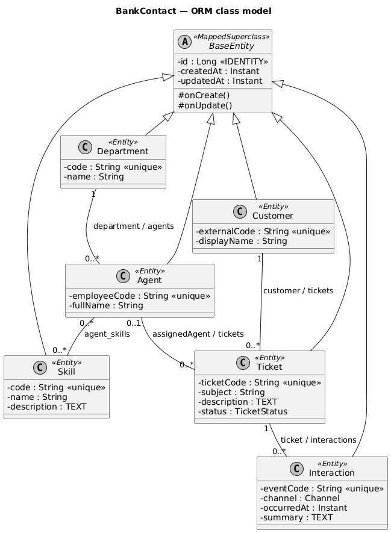
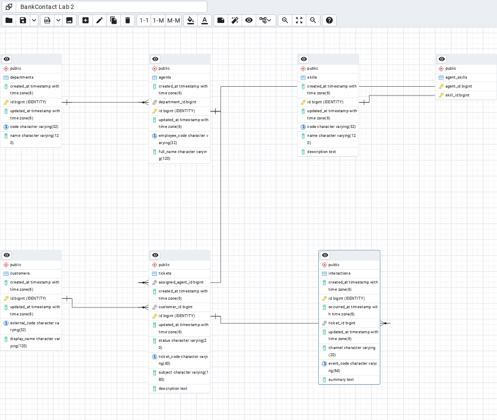

# BankContact — Лабораторна робота 2

**Морозов Єгор, ІУС-601.** Дисципліна: «Технології Індустрії 4.0, 5.0 в інформаційних управляючих системах».

BankContact цифровізує послуги банківського кол-центру: збирає звернення та події взаємодій, пов'язує їх із клієнтами й операторами та формує основу автоматичного маршрутизування й аналітики. Реальні персональні дані в прикладі не використовуються.

## Стек
Java 17, Spring Boot 3.5.7, Maven, Spring Data JPA / Hibernate, Lombok, PostgreSQL 17. Додатковий контейнер pgAdmin доступний для огляду схеми.

## Модель
Шість сутностей: Department, Agent, Skill, Customer, Ticket, Interaction.
Спільні id, createdAt, updatedAt успадковуються від BaseEntity (@MappedSuperclass).
- Department 1 → N Agent.
- Customer 1 → N Ticket.
- Agent 0..1 → N Ticket.
- Ticket 1 → N Interaction.
- Agent M ↔ N Skill через agent_skills.

Зворотні OneToMany використовують mappedBy, а власник ManyToMany — Agent з явною JoinTable. Каскад REMOVE не застосовується до спільних навичок і даних історії. Lombok використовується без @Data та equals/hashCode за асоціаціями, щоб уникнути рекурсії і змінного hashCode у Set.

ER-діаграма, згенерована у pgAdmin з фактичної локальної БД:

## Запуск у Windows 11

Потрібні JDK 17, Maven 3.6.3+ та Docker Desktop (або окремий PostgreSQL).

У PowerShell у папці проєкту:

~~~powershell
docker compose up -d --wait
mvn -DskipTests package
java -jar target/bankcontact-0.0.1-SNAPSHOT.jar --spring.profiles.active=demo
~~~

Профіль demo **пересоздає таблиці в зазначеній БД** через ddl-auto=create. Використовуйте лише окрему навчальну bankcontact_lab2. Він додає по 2 записи до кожної сутнісної таблиці та 4 пари до agent_skills, щоб показати обидві сторони M:N. Застосунок цієї лабораторної — консольний; після виконання CommandLineRunner він завершується, дані залишаються у PostgreSQL.

Без demo: ddl-auto=update, завантаження демонстраційних даних вимкнено.

### Власний PostgreSQL замість Docker
Створіть роль і порожню БД від імені адміністратора (навчальний пароль у прикладі):

~~~sql
CREATE ROLE bankcontact LOGIN PASSWORD 'bankcontact_dev';
CREATE DATABASE bankcontact_lab2 OWNER bankcontact;
~~~

За потреби змініть параметри PowerShell:
~~~powershell
$env:DB_URL="jdbc:postgresql://localhost:5432/bankcontact_lab2"
$env:DB_USER="bankcontact"
$env:DB_PASSWORD="bankcontact_dev"
~~~

### pgAdmin
Відкрити http://localhost:5050. Навчальний логін student@example.com, пароль pgadmin_dev (можна змінити через PGADMIN_PASSWORD перед docker compose).
Register Server:
- Name: BankContact Lab 2
- Host: postgres (усередині Docker-мережі; для локального pgAdmin — localhost)
- Port: 5432
- Maintenance database: bankcontact_lab2
- Username: bankcontact
- Password: bankcontact_dev

Schemas → public → Tables має містити 7 таблиць. Для ERD: вибрати public → контекстне меню Generate ERD. Виконати sql/verify.sql у Query Tool. Схему БД створює Hibernate, а не цей SQL-файл.

## Перевірки
~~~powershell
mvn verify
~~~
Увага: інтеграційні тести також активують demo і пересоздають навчальну БД.

Тести перевіряють записи, FK, IDENTITY, індекси, обидві сторони асоціацій, відхилення дублів, недійсних FK та аудит оновлень. Workflow .github/workflows/verify.yml запускає їх на PostgreSQL 17 і зберігає результати та дамп схеми як Actions artifact.

### Фактично виконана локальна перевірка
- Maven package: BUILD SUCCESS.
- Spring Boot demo: exit 0.
- Hibernate створив 7 таблиць, 6 FK, 18 індексів (5 явних, 7 PK, 6 UNIQUE).
- Дев'ять перевірок каталогу/цілісності пройшли; див. evidence/validation.txt і database-metadata.json.
- Локально використано PostgreSQL 18.6 у WASM-збірці PGlite 0.5.15 через PostgreSQL JDBC, оскільки нативний сервер у поточному середовищі не може стартувати від root. Це не перевірка багатокористувацького нативного сервера; стандартний запуск на PostgreSQL 17 відтворюється через compose/Actions.
- Локально пройшли всі 6 JUnit-тестів (Failures: 0, Errors: 0), зокрема асоціації та @PreUpdate. Результат: evidence/junit-local.txt.
- **На нативному PostgreSQL 17.11 GitHub Actions завершився успішно:** 6 тестів, 0 помилок, BUILD SUCCESS. Експорт схеми й SQL-перевірка також успішні. [Результат запуску](https://github.com/proxyfied/bankcontact-industry4-labs/actions/runs/41759219066). Перевірений коміт: 1268a4de2d9d0c11c92125d89a3ca736ac06ba70.

## Обсяг лабораторної
Реалізовано ORM-модель, генерацію схеми, репозиторії та контрольне наповнення. Вебінтерфейс, автоматичне SLA-маршрутизування та AI-помічник належать наступним роботам і тут не реалізовані.

## Джерела
- https://docs.spring.io/spring-boot/3.5/
- https://docs.hibernate.org/orm/6.6/userguide/html_single/
- https://www.postgresql.org/docs/current/ddl-constraints.html
- https://www.pgadmin.org/docs/pgadmin4/latest/erd_tool.html
