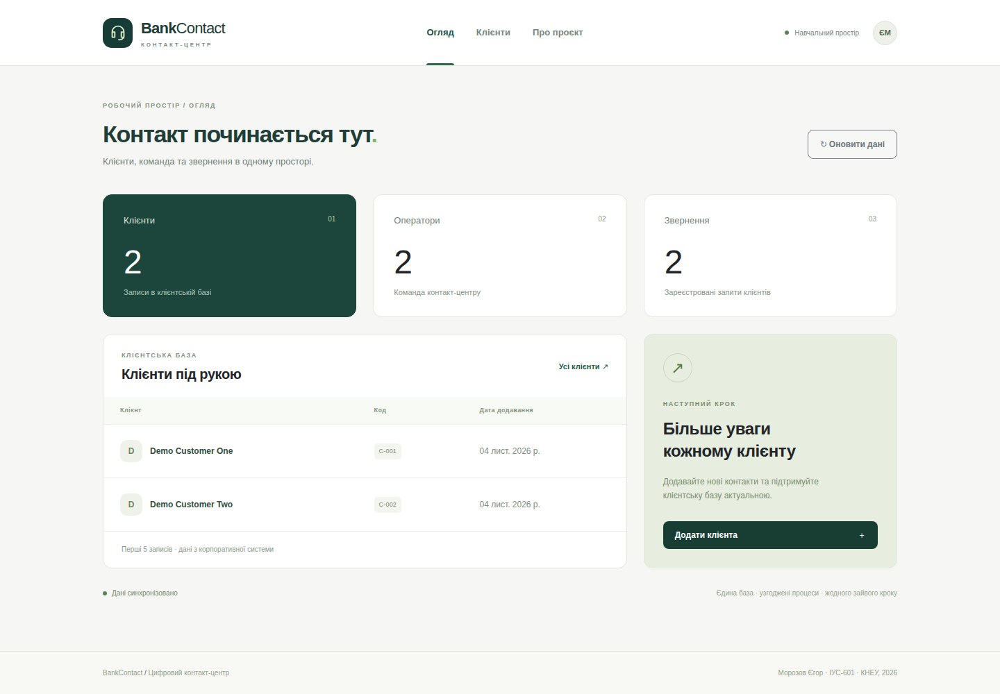

# BankContact — лабораторні 1–5

## ЛР5 — Spring AI та структурування статей

Модуль [ai-articles](ai-articles) реалізує Spring Boot 3.5.15, Spring AI 1.1.8, GPT-4o-mini, Jackson Record із 36 полями та форму Thymeleaf. Він запускається окремим сервісом на **8082**; меню Vue містить посилання «AI статті». Основна система ЛР4 залишається на Spring Boot 4 / 8080.

~~~powershell
.\mvnw.cmd -f ai-articles/pom.xml verify
$key = Read-Host "OpenAI API key" -AsSecureString
$env:OPENAI_API_KEY = [System.Net.NetworkCredential]::new("", $key).Password
java -jar ai-articles/target/bankcontact-ai-articles-0.0.5-SNAPSHOT.jar
~~~

Відкрити http://localhost:8082/articles. Ключ читається лише на сервері, у Git його немає. Без ключа форма доступна, а генерація повертає 503 із поясненням. [Контракт, поля й порядок тестування](ai-articles/README.md).

**Межа перевірки:** автоматичні тести використовують локальний HTTP-стаб OpenAI, а не реальну LLM. Вони перевіряють інтеграцію Spring AI, парсинг та UI; якість і час живої генерації потребують запуску з власним API-ключем. Тестовий режим явно позначено в UI.

Версію ЛР4 збережено в [lab4-vue-client](https://github.com/proxyfied/bankcontact-industry4-labs/tree/lab4-vue-client).

## ЛР4 — Vue та корпоративний REST API

ЛР4 додає адаптивний клієнт **Vue 3 + Vite + axios + Vue Router + Bootstrap 5** до Spring Boot 4 REST API з ЛР3.

- **Огляд**: фактичні кількості клієнтів, операторів і звернень; перші 5 клієнтів.
- **Клієнти**: список із серверною пагінацією, додавання, редагування та підтвердження видалення; обробка помилок 400/404/409 і відсутності зв’язку.
- **Про проєкт**: призначення та архітектура системи.

## Запуск повного застосунку на Windows

Потрібні Java 17, Node.js 22.12+ (або 24 LTS), Docker Desktop.

~~~powershell
docker compose up -d --wait
npm --prefix frontend ci
npm --prefix frontend run build:backend
.\mvnw.cmd -DskipTests package
java -jar target/bankcontact-0.0.3-SNAPSHOT.jar --spring.profiles.active=demo
~~~

Відкрити **http://localhost:8080**. Vue обслуговується з JAR, axios звертається до `/api`, Spring Boot працює з PostgreSQL. Профіль `demo` пересоздає таблиці і додає навчальні записи: використовуйте лише окрему навчальну БД. Для збереження даних після перезапуску запускайте JAR без demo; за замовчуванням `ddl-auto=update`.

Для розробки клієнта окремо: `npm --prefix frontend run dev`, Vite проксіює `/api` на 8080. [Конфігурація фронтенду і перевірка в браузері](frontend/README.md).

Попередні реалізації збережено: [ЛР2 ORM](https://github.com/proxyfied/bankcontact-industry4-labs/tree/lab2-orm), [ЛР3 REST API](https://github.com/proxyfied/bankcontact-industry4-labs/tree/lab3-rest-api).

## Перевірка ЛР4

[Успішний запуск GitHub Actions](https://github.com/proxyfied/bankcontact-industry4-labs/actions/runs/41764755479): **22 тести JUnit, 59 перевірок Newman і 7 наскрізних тестів Chromium** на PostgreSQL 17. Vue перевіряється саме з production-збірки всередині JAR.

[Скріншоти всіх сторінок та CRUD](evidence/lab4/screenshots) · [Звіт Playwright](evidence/lab4/playwright-results.json) · [Схема інтеграції](docs/lab4/architecture.puml).

## Backend і матеріали ЛР3

**Морозов Єгор, ІУС-601.** Технології Індустрії 4.0, 5.0 в інформаційних управляючих системах.

Серверна частина банківського кол-центру на **Spring Boot 4.0.9**. API цифровізує клієнтів, операторів і звернення та працює з ORM-моделлю з ЛР2. Дані демонстрації синтетичні.

[Версія ЛР2 на Spring Boot 3.5.7](https://github.com/proxyfied/bankcontact-industry4-labs/tree/lab2-orm) збережена окремою гілкою.

## Архітектура
Vue.js (клієнт) → HTTP/JSON → Controller → Service → Repository → Entity → PostgreSQL.

Реалізовано один автономно розгортуваний бізнес-сервіс BankContact API. Три контролери є ресурсами одного сервісу, а не трьома мікросервісами. REST-контракт і зовнішня конфігурація дозволяють включити його до мікросервісної системи. Frontend, gateway та discovery до обсягу цієї роботи не входять.

- DTO відокремлюють API від JPA-сутностей і запобігають рекурсивній серіалізації.
- Транзакції та бізнес-правила розміщені в сервісах.
- Списки мають пагінацію: page ≥ 0, size від 1 до 100, сортування за id.
- Agent.department завантажується EntityGraph, колекція навичок — пакетно через BatchSize.
- Backend не зберігає користувацьку HTTP-сесію.
- Фактичну пропускну здатність і горизонтальне масштабування навантажувальними тестами не вимірювали.

## Технології
Java 17, Maven, Spring Boot 4.0.9, Spring Web MVC, Spring Data JPA/Hibernate,
PostgreSQL, Lombok, DevTools, Jakarta Validation. Скелет і Maven Wrapper отримано зі Spring Initializr; див. [параметри генерації](docs/lab3/initializr.md).

## Швидкий запуск у Windows 11
Потрібні JDK 17 і Docker Desktop. Maven можна використовувати через включений Wrapper.

PowerShell у корені проєкту:
~~~powershell
docker compose up -d --wait
.\mvnw.cmd -DskipTests package
java -jar target/bankcontact-0.0.3-SNAPSHOT.jar --spring.profiles.active=demo
~~~

API: http://localhost:8080/api/customers. Сервер працює до Ctrl+C.

Профіль **demo пересоздає таблиці** та додає початкові записи. Запускайте його лише з окремою навчальною БД. Без demo застосовується ddl-auto=update і наповнення вимкнено. Назва bankcontact_lab2 збережена для продовження попередньої роботи.

Налаштування змінними середовища:
~~~powershell
$env:DB_URL="jdbc:postgresql://localhost:5432/bankcontact_lab2"
$env:DB_USER="bankcontact"
$env:DB_PASSWORD="bankcontact_dev"
$env:PORT="8080"
$env:CORS_ALLOWED_ORIGINS="http://localhost:5173,http://localhost:8081"
~~~

## REST API
Префікси: /api/customers, /api/agents, /api/tickets.

| Метод | Шлях для кожного ресурсу | Успішна відповідь |
|---|---|---|
| GET | /api/{resource}?page=0&size=20 | 200, PageResponse |
| GET | /api/{resource}/{id} | 200, DTO |
| POST | /api/{resource} | 201, DTO та Location |
| PUT | /api/{resource}/{id} | 200, DTO після повного оновлення |
| DELETE | /api/{resource}/{id} | 204, без тіла |

Для POST і PUT потрібен Content-Type: application/json. PUT потребує повного набору обов'язкових полів; він не створює відсутній ресурс.

Приклад POST /api/customers:
~~~json
{"externalCode":"C-API-001","displayName":"Demo API Customer"}
~~~

Приклад POST /api/agents:
~~~json
{"employeeCode":"OP-API-001","fullName":"Demo API Agent","departmentId":1,"skillIds":[1,2]}
~~~

Приклад POST /api/tickets:
~~~json
{"ticketCode":"T-API-001","subject":"Card question","description":"Synthetic request","status":"NEW","customerId":1,"assignedAgentId":1}
~~~

Ідентифікатори у прикладах відповідають початковому demo-наповненню; перевірте їх через GET. Department і Skill — довідники з ЛР2. Стани звернень: NEW, IN_PROGRESS, RESOLVED, CLOSED; assignedAgentId може бути null.

Помилки API мають JSON-формат ProblemDetail:
- 400 — невалідний JSON, поля, id або параметри пагінації.
- 404 — ресурс або пов'язаний запис відсутній.
- 409 — дубль бізнес-коду або порушення правила видалення.
- 415 — тіло POST/PUT не у форматі JSON.

Клієнта зі зверненнями, оператора з призначеними зверненнями та звернення з історією взаємодій видалити не можна. Колекція Postman створює власні записи і видаляє їх у порядку Ticket → Agent → Customer.

## CORS для Vue.js
Дозволені origin за замовчуванням: http://localhost:5173 та http://localhost:8081.
Методи GET, POST, PUT, DELETE, OPTIONS; заголовки Content-Type, Accept, Authorization.
Location доступний frontend через exposedHeaders. Cookies/credentials не вмикаються.
Невідомий origin відхиляється; CORS перевіряється браузером, Postman сам по собі CORS не блокує, тому колекція явно перевіряє preflight.

## Postman і Newman
1. Import → [BankContact_Lab3.postman_collection.json](postman/BankContact_Lab3.postman_collection.json).
2. Import → [BankContact_Local.postman_environment.json](postman/BankContact_Local.postman_environment.json).
3. Вибрати середовище BankContact Local, запустити всі папки Collection Runner у заданому порядку.

24 HTTP-запити охоплюють POST/GET/PUT/DELETE трьох ресурсів, пагінацію, негативні сценарії й OPTIONS preflight. Ідентифікатори передаються через змінні, бізнес-коди отримують унікальний токен запуску.

Запуск тієї самої колекції через CLI Postman Newman (Node.js 16+):
~~~powershell
npx --yes newman@6.2.1 run postman/BankContact_Lab3.postman_collection.json -e postman/BankContact_Local.postman_environment.json --bail --reporters cli,json --reporter-json-export newman-report.json
~~~
Колекція має формат v2.1; це реальна колекція Postman, а Newman — її CLI-runner. Відкриття GUI Postman в автоматизованому прогоні не імітується.

## Тести та CI
~~~powershell
.\mvnw.cmd verify
~~~

6 ORM-тестів і 16 API-тестів перевіряють моделі, CRUD, валідацію, конфлікти,
зв'язки, правила видалення та CORS. Тести активують demo і пересоздають навчальну БД.

GitHub Actions запускає ці тести на PostgreSQL 17, після чого запускає JAR і виконує Postman-колекцію Newman через реальні HTTP-з'єднання. Артефакт lab3-postgresql-rest-validation містить JUnit-результати, звіт Newman, журнал сервера й дамп схеми.

Фактичні результати ЛР3 зберігаються в evidence/lab3/. Історичні файли evidence/ у корені належать ЛР2.

Підтверджено на PostgreSQL 17: **22 тести JUnit, 24 HTTP-запити, 59 перевірок Newman — усі успішні**. [Результати GitHub Actions](https://github.com/proxyfied/bankcontact-industry4-labs/actions/runs/41761399192).

## Документація
- [Повний контракт ресурсів](docs/lab3/api.md)
- [Spring Boot 4 Servlet API](https://docs.spring.io/spring-boot/4.0/reference/web/servlet.html)
- [Spring MVC CORS](https://docs.spring.io/spring-framework/reference/web/webmvc-cors.html)
- [Newman](https://learning.postman.com/docs/reference/newman-cli/command-line-integration-with-newman/)
